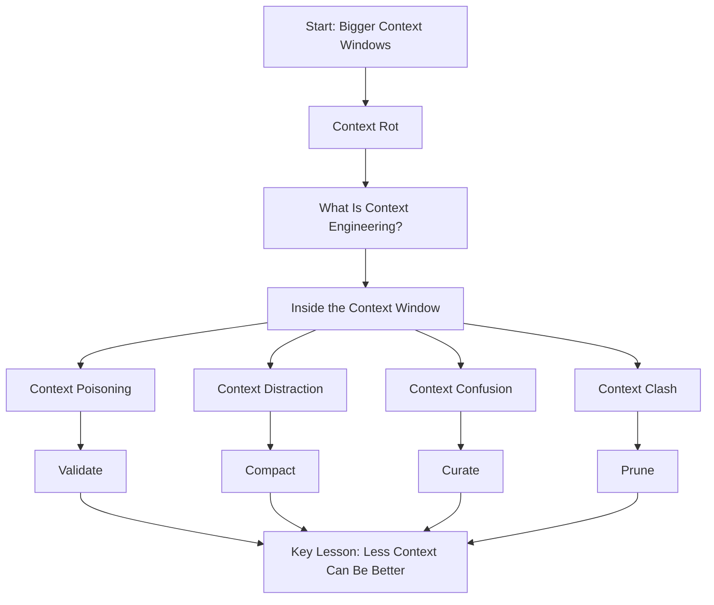

# Bigger Context Windows, Better AI Agents? Not So Fast

**Short answer:** Bigger context windows help, but they do not automatically make AI agents better. As context grows, models can become less reliable because attention is finite.

The practical fix is **context engineering**: deciding what information an agent actually needs at each step, and removing the rest.

## How to read this wiki

| Page | What you learn |
|---|---|
| [1. Bigger Context Windows](Context-Engineering/wiki/01-Bigger-Context-Windows) | Why bigger context is not automatically better |
| [2. Context Rot](02-Context-Rot) | Why models become less reliable as context grows |
| [3. What Is Context Engineering?](03-What-Is-Context-Engineering) | What context engineering means and why it matters |
| [4. Inside an Agent Context Window](04-Inside-Agent-Context-Window) | What fills up an AI agent’s context window |
| [5. Context Poisoning](05-Context-Poisoning) | How wrong information becomes “truth” |
| [6. Context Distraction](06-Context-Distraction) | How long history derails agent behavior |
| [7. Context Confusion](07-Context-Confusion) | Why too many tools reduce accuracy |
| [8. Context Clash](08-Context-Clash) | How conflicting information breaks reasoning |
| [9. Context Engineering Fixes](09-Context-Engineering-Fixes) | Validate, compact, curate, and prune |
| [10. Key Lesson](10-Key-Lesson) | Why less context can produce better agents |
| [Cheat Sheet](Cheat-Sheet) | One-page summary |
| [Glossary](Glossary) | Key terms |

## Big picture

## If you only have one minute

- More tokens in the context window does **not** mean better performance.
- Every token competes for a finite amount of model attention.
- Four common failure modes are:
  - **Context poisoning**
  - **Context distraction**
  - **Context confusion**
  - **Context clash**
- Four matching fixes are:
  - **Validate**
  - **Compact**
  - **Curate**
  - **Prune**

## Failure modes at a glance

| Failure mode | What happens | Practical fix |
|---|---|---|
| Context poisoning | A wrong conclusion enters the context and is treated as fact | Validate conclusions before saving them |
| Context distraction | Long history becomes the strongest pattern and steers the agent | Compact history and move details to files |
| Context confusion | Too many tools or instructions make the right choice harder | Curate the tools available to the task |
| Context clash | The context contains conflicting information | Prune stale information or restart with corrected state |

## Key terms

| Term | Simple meaning |
|---|---|
| Context window | The amount of information the model can consider at once |
| Context rot | Reduced reliability as the context window gets larger |
| Context engineering | Choosing what information the agent sees at each step |
| Tool definition | A description of a tool the agent can call |
| Compaction | Summarizing or shrinking long agent history |
| Pruning | Removing old or superseded information |

## Start here

Begin with [1. Bigger Context Windows](01-Bigger-Context-Windows), then move through the pages in order.

If you want the fastest summary, read the [Cheat Sheet](Cheat-Sheet) first.
